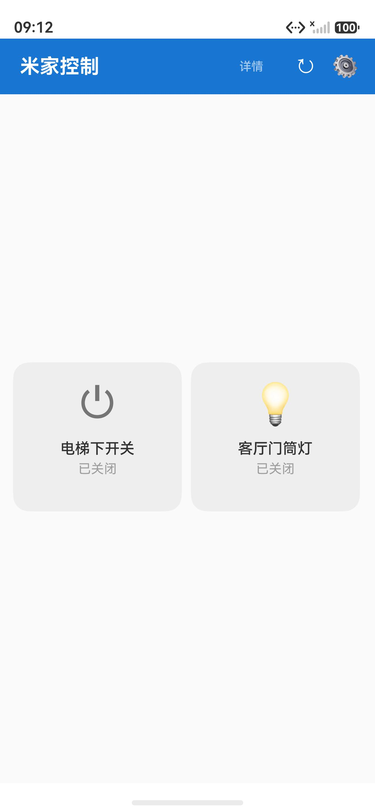
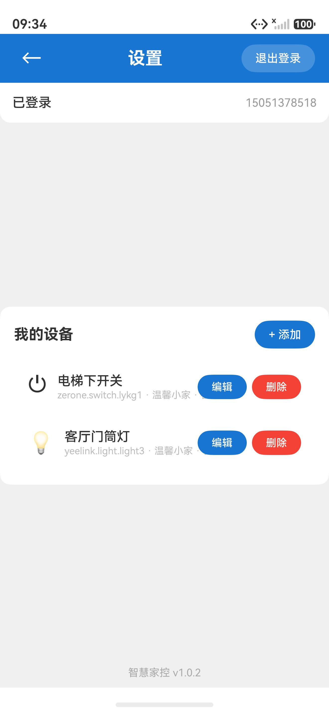
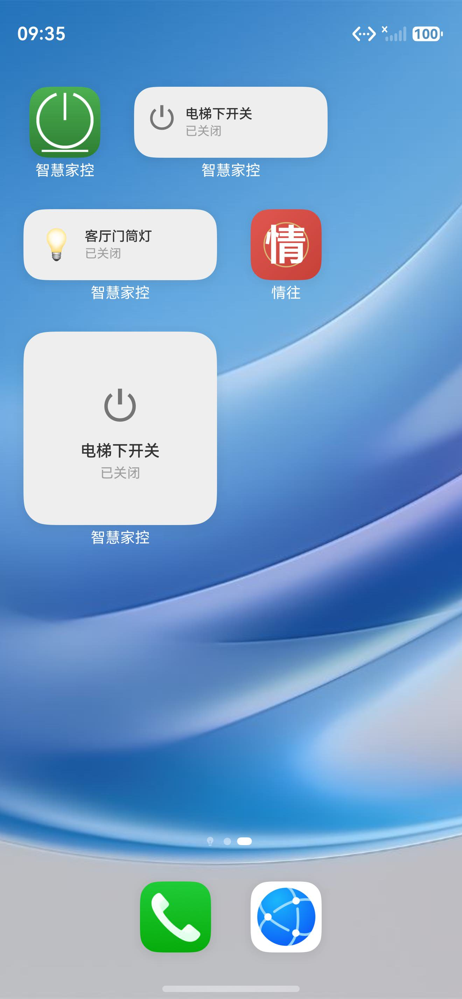

# Zhihui Jiakong (智慧家控)

[简体中文](./README.md) | **English**

An unofficial third-party Mi Home (Xiaomi smart home) device control app for HarmonyOS.

**Core highlight: one-tap control from home-screen widgets** — bind any Mi Home device to home-screen service widgets in 4 sizes (1×2 / 2×2 / 2×4 / 4×4) and **toggle the device directly on the home screen without opening the app**, with live status shown on the widget.

> The official Mi Home app on HarmonyOS **does not support device home-screen service widgets** — there is no way to "pin" a device switch to the home screen for one-tap control. This app was built to fill that gap.

After signing in with your Xiaomi account, you can manage Mi Home device switches on the phone and pin frequently used devices to the home screen, using them like wall switches.

> ⚠️ **This is an unofficial third-party app** implemented by reverse-engineering Mi Home cloud APIs, for learning and research purposes only. Please read the [disclaimer](#disclaimer) at the end.

## Features

- **Account login**: Xiaomi account sign-in with phone number + password, with SMS OTP (verification code) two-step verification and resend support
- **Device management**
  - Automatically discovers all Mi Home devices under your account (including shared-home devices)
  - Search, add, and remove devices by name/model
  - Custom device nickname and icon (18 icons to choose from)
  - Multi-gang switch support (2-gang/3-gang switches are automatically split into independent control slots)
  - Per-device "momentary mode": turns off automatically after a tap, suitable for elevator/door-access buttons
- **State control**
  - Device switch states auto-refresh every 5 seconds
  - Real-time device offline indication
  - Normal devices toggle on tap; momentary devices turn off automatically, with a forced off command if they do not close within 5 seconds
- **Home-screen widgets (core feature)**
  - 4 sizes: 1×2 / 2×2 / 2×4 / 4×4, blending natively with the system launcher
  - Toggle devices directly on the widget, without opening the app
  - Normal devices use latching toggle; momentary devices turn off automatically after being triggered
  - Each widget binds to one device slot independently; multiple widgets can bind different devices
  - Unbound widgets guide you into the device selection page on tap — configure once, use forever
  - After each tap, the device state is polled in real time and the widget color reflects it (on/off/offline)
  - Background periodic sync + proactive push on in-app changes keeps widget states consistent with devices
- **Automatic token renewal**: serviceToken refreshes silently on expiry, keeping you signed in long-term

## Screenshots

|  |  |
|:---:|:---:|
| Home (device card wall) | Settings (login / device management) |

<p>
  
  <br>Home-screen widgets (1×2 / 2×2): tap to toggle devices without opening the app
</p>

## Project Structure

```
entry/src/main/ets/
├── common/
│   ├── GlobalContext.ets    # Global context
│   └── StatusTexts.ets      # Shared status text constants (service layer)
├── entryability/            # UIAbility entries
│   ├── EntryAbility.ets     # Main entry
│   └── WidgetEditAbility.ets# Widget device-binding page entry
├── formability/
│   └── ElevatorFormAbility.ets  # Widget backend (message handling / state polling / refresh)
├── mijia/                   # Business service layer
│   ├── MiAuthService.ets    # Login state management & silent renewal
│   ├── MiDeviceService.ets  # Device list / state / switch control (batch query)
│   ├── PreferencesUtil.ets  # preferences persistence (process-level cache strategy)
│   ├── AssetTokenStore.ets  # Asset Store secure credential storage (with plaintext migration)
│   └── PreferencesTokenStore.ets  # preferences fallback storage
├── mi/                      # Mi Home protocol layer
│   ├── MiAccount.ets        # Xiaomi account login (incl. OTP flow)
│   ├── MiIOService.ets      # miot device API (signed requests / property read & write)
│   ├── MiHttpTransport.ets  # HTTP transport & cookie management
│   ├── MiTokenStore.ets     # Token storage interface
│   ├── CookieParser.ets     # Set-Cookie parsing (pure functions, unit-testable)
│   ├── LoginCooldown.ets    # Login rate-limit cooldown (pure logic, unit-testable)
│   ├── CryptoUtil.ets       # MD5/SHA/HMAC/Base64
│   ├── MiDebug.ets          # Debug logging
│   └── types.ets            # Data models & device profile table
├── pages/
│   ├── Index.ets            # Home page (device card wall)
│   ├── SettingsPage.ets     # Settings page (login / device management)
│   └── WidgetEditPage.ets   # Widget device-binding page
└── widget/pages/
    └── ElevatorWidget.ets   # Home-screen widget UI (4 sizes)
```

## Download & Install

- **Direct download**: get the unsigned HAP from [Releases](https://github.com/jjkk52/zhihuijiakong/releases) (`zhihuijiakong-v1.0.3-unsigned.hap`)
- **Build from source**: clone this repository and build with DevEco Studio (see [Build & Run](#build--run))

> ⚠️ This project is distributed as an **unsigned package**. An unsigned HAP **cannot be installed directly** on a device; debug signing is required first.

### Install via open-source signing tools (no DevEco Studio, recommended)

Skip the multi-GB DevEco Studio download — with just a Huawei developer account, the following community open-source tools can "sign + install" in one click:

| Tool | Platform | Highlights |
|---|---|---|
| [Xiaobai Debug Assistant auto-installer](https://github.com/likuai2010/auto-installer) | Windows / macOS / Linux | Most popular in the community: auto-generates debug certificate & profile after Huawei account sign-in; one-click sign, install, and launch |
| [HarmonyOS HAP Installer](https://github.com/amw1933/hap-installer) | Windows | Portable single-file exe: sign in with your Huawei account, drag the HAP into the window, done |
| [HapInstaller](https://github.com/LMV475/hap-installer) | HarmonyOS phone | Once installed on the phone, it can sign and install other HAPs **entirely PC-free** |

General flow: enable USB / wireless debugging on the phone → connect it to a computer → sign in with your Huawei account in the tool → import the downloaded unsigned HAP → one-click sign & install.

> These are third-party open-source tools (the signing profile is bound to your own Huawei account and devices). Evaluate their security yourself before use; for more sideloading practice see [harmonyos-sideload-guide](https://github.com/Richard1037/harmonyos-sideload-guide).

### Build from source with DevEco Studio

Clone this repository and build with DevEco Studio — see [Build & Run](#build--run).

## Build & Run

### Requirements

- [DevEco Studio](https://developer.huawei.com/consumer/cn/deveco-studio/) 6.1 or later
- HarmonyOS SDK 6.1.1 (API 24), compatible with 6.1.0 (API 23)
- A HarmonyOS phone (developer mode + USB debugging) or an emulator
- ⚠️ **The project path must contain only ASCII characters** (letters, digits, `-`, `_`, `.`). Paths containing Chinese characters break the hvigor build; make sure the clone target folder name contains no Chinese characters

### Steps

1. Clone the repository and open the project root in DevEco Studio
2. On first open you will be prompted about missing signing: go to `File > Project Structure > Signing Configs` and check **Automatically generate signature** to generate a local debug signature
3. Connect a device and press Run (or build via the `hvigorw` command line)

### About signing (this project ships unsigned)

This project is distributed as an **unsigned package**: the repository contains no signing materials, the release signing info in `build-profile.json5` has been sanitized (passwords and cert paths cleared), and HAPs built after cloning carry no release signature.

- **Local debug runs**: on first open, go to `File > Project Structure > Signing Configs`, check **Automatically generate signature**, then build and install the debug package
- **Distributing/using the unsigned package**: an unsigned HAP cannot be installed directly; users must sign it themselves (e.g. via DevEco Studio auto-signing, or by applying for certificates) before installing
- **Configuring release signing yourself** (optional): apply for a release certificate (`.cer`), profile (`.p7b`), and keystore (`.p12`) on [AppGallery Connect](https://developer.huawei.com/consumer/cn/service/josp/agc/index.html), fill them into the `release > material` field of `build-profile.json5`, or configure via DevEco Studio `File > Project Structure > Signing Configs`

## Permissions

| Permission | Purpose |
|---|---|
| `ohos.permission.INTERNET` | Access Mi Home cloud APIs (login, device list, switch control) |
| `ohos.permission.GET_NETWORK_INFO` | Query network state |

## Home-Screen Widget Guide (Core Feature)

1. Add a "Zhihui Jiakong" widget to the home screen (long-press the home screen > Service widgets, pick 1×2 / 2×2 / 2×4 / 4×4)
2. Tap an unbound widget to open the device selection page and choose a device slot to bind
3. Once bound, tapping the widget toggles the device directly — no need to open the app at any point; the widget color indicates the state:
   - Light green background = on; light gray = off; light red = device offline
4. For elevator/door-access momentary devices: open the device's "Edit" panel in Settings and enable "Momentary mode". Tapping the widget turns the device on; once the device closes automatically, the widget returns to "Off". If it does not close within 5 seconds, the app sends a forced off command
5. Widget states refresh automatically on a system schedule (roughly every 30 minutes); after a tap, the real device state is polled immediately and the widget refreshed, ensuring what you see is what you control
6. Add multiple widgets bound to different devices (e.g. living-room light, elevator switch, water heater) to build your own home-screen control panel

## Changelog

### v1.0.3
- Added per-device "momentary mode": turns off automatically after a tap, with a forced off command if it does not close within 5 seconds
- Unified widget and home-page status text to "On / Off"
- Fixed duplicate triggering on rapid taps and cross-talk between multi-gang device states

## Security & Quality

- **Credential security**: Mi Home login credentials are stored securely via the system-level **Asset Store**, with automatic migration of legacy plaintext data on first upgrade; if the Asset service fails, storage automatically falls back to local preferences for availability
- **Request security**: all cloud requests go over HMAC-SHA256-signed HTTPS
- **Testing**: unit tests cover the core pure logic (crypto known-answer vectors, cookie parsing, device profile clone isolation, etc.)

For a full analysis of historical issues and improvements, see [IMPROVEMENTS.md](./IMPROVEMENTS.md) (all listed issues are fixed, with an implementation status table; in Chinese).

## References & Acknowledgements

The Mi Home cloud protocol layer (`entry/src/main/ets/mi/`) of this project references and was ported from the following open-source projects:

### [Yonsm/MiService](https://github.com/Yonsm/MiService) (MIT License, PyPI package `miservice`)

A Python library for Xiaomi cloud services. The following implementations were ported to ArkTS with its **v3.0.2** as reference:

- Xiaomi account login flow (serviceLogin / serviceLoginAuth2 / serviceToken client-side signing, incl. SMS/email OTP two-step verification and resend)
- Cookie management and request UA conventions in the HTTP transport layer
- Signed requests and batch property read/write for the MiIO device API (`/miotspec/prop/get|set`)
- Login rate-limit protection: detects Xiaomi rate-limit error code `70022`; after 5 consecutive failures a 2-hour cooldown begins, during which no further login requests are sent, preventing further server-side account lockout

### [jjkk52/MiService](https://github.com/jjkk52/MiService) (MIT License)

A fork of the above project. Its "family-member account sees an empty device list" fix (commit `69881ce`) has been fully absorbed into this project:

- Home/room APIs switched to `/v2/homeroom/gethome` with `fetch_share` / `fetch_share_dev` parameters
- Merges `homelist` with `share_home_list`, so family-member accounts can also see shared homes and devices
- Device list switched to `/v2/home/device_list_page`, fetching explicit dids in batches (50 per batch); shared devices are no longer lost

Original copyright and licenses of the above projects can be found in the [LICENSE](https://github.com/Yonsm/MiService/blob/main/LICENSE) file in their repositories.

## Disclaimer

1. This project is an **unofficial** third-party tool with no affiliation with Xiaomi
2. The Xiaomi cloud APIs it calls were obtained by reverse engineering and are **not official open APIs**; Xiaomi may change them or restrict unofficial clients at any time
3. Using this app requires your Xiaomi account credentials; they are stored only in the device's local sandbox and never relayed through any third-party server. However, be aware that using unofficial clients carries a theoretical risk of account risk control
4. This project is for personal learning and technical research only; commercial use is prohibited. Users bear all consequences of using this project
